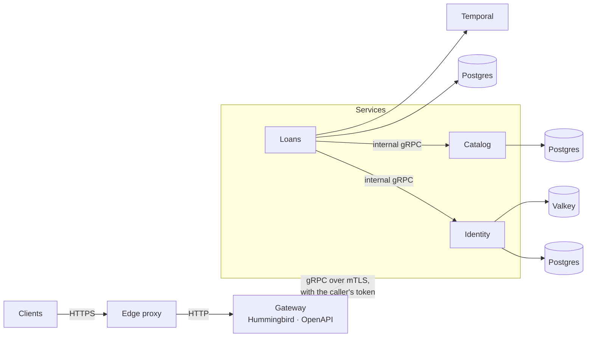

# Swift Microservices Architect

[](https://github.com/swift-microservices/swift-microservices-architect-skill/actions/workflows/validate.yml)
[](LICENSE)

An [agent skill](https://agentskills.io) that teaches Claude to design, build and review Swift server backends: gRPC microservices behind a Hummingbird API gateway, with clear module boundaries, modern Swift, and the production essentials built in, from Postgres row-level security to durable Temporal workflows.

Ask for a plan, a new service, an endpoint, a background process or a review, and the agent answers with the same architecture, names and code style every time.

## The architecture



- **A service per capability.** Each service owns its data and the rules over it. No service reads another's database; data crosses only through gRPC contracts.
- **Boundaries the compiler enforces.** A service is one Swift package. Its Core target holds the models and use cases and imports no driver or transport; adapters for Postgres, gRPC, Temporal and Valkey sit around it; one executable wires them together. Each target declares what it imports, so most crossings fail the build, and the review checklist's boundary checks catch the rest.
- **Code that reads like the requirement.** Use cases read top to bottom, the way Apple's sample code does: typed throws, one `catch` per outcome, no helper methods.
- **Security on every hop.** Mutual TLS between processes, the caller's token verified again by every service, and row-level security under every tenant query.
- **Durable work on Temporal.** Anything that waits, retries or spans services is a workflow, never a fire-and-forget task.
- **Modern Swift.** Swift 6 language mode with strict concurrency, structured concurrency only, `package` access, and owned code importing `FoundationEssentials`, so a service drops full Foundation once its dependencies do.

The skill's examples follow Bookshelf, a small lending library. Its loans service is one package:

```
bookshelf-loans
├── LoansCore       models, use cases, repository and port protocols
├── LoansPostgres   repositories, row-level security, migrations
├── LoansGRPC       the gRPC services, and clients for other services
├── LoansTemporal   workflows and activities
├── LoansResend     the email provider behind Core's notice port
└── Loans           the executable: configuration, wiring, lifecycle
```

## Installation

**Claude Code**

```
/plugin marketplace add swift-microservices/swift-microservices-architect-skill
/plugin install swift-microservices-architect@swift-microservices-architect-skill
```

**skills CLI**

```bash
npx skills add https://github.com/swift-microservices/swift-microservices-architect-skill --skill swift-microservices-architect
```

**Manually**

Copy `skills/swift-microservices-architect/` into `~/.claude/skills/` for all your projects, or into a repository's `.claude/skills/` to share it with the team.

## Usage

Claude loads the skill when a task matches it, or when asked with `/swift-microservices-architect` (`/swift-microservices-architect:swift-microservices-architect` when installed as a plugin). For example:

- "Plan a backend for a lending library with accounts, a book catalog and loans."
- "Add an endpoint for returning a book."
- "When a loan passes its due date, mark it overdue and email the member."
- "Set up CI/CD for the loans service."
- "Review this service's architecture and code style."

To plan a backend, add a service, an operation or a durable process, set up CI/CD or review a backend, the agent follows the skill's checklist, and one that changes code ends with a build and a test run repeated until both pass.

## What it covers

| Area | Covers |
|---|---|
| System design | Splitting a backend into services, contracts, how services talk, the written plan |
| Packages | Targets and their dependency rules, `Package.swift`, Swift settings, the shared `<org>-core` and `<org>-protos` packages |
| Application layer | Models, errors, repositories, ports and typed-throws use cases, transactions, authorization |
| Persistence | Postgres roles and row-level security, statements, paging, migrations, Valkey |
| gRPC | Contracts, services, handlers, conversions, status codes, clients, transports |
| Gateway | OpenAPI types, request contexts by tier, controllers, webhooks, problem details |
| Workflows | Temporal workflows and activities, determinism, retries, versioning, the worker |
| Composition | Commands, configuration, logging, and graceful shutdown |
| Security | mTLS with certificate reloading, JWTs and key rotation, secrets, webhook signatures |
| Testing | A test target per module, over hand-written mocks |
| Delivery | GitHub Actions CI, semantic-version releases, images on GitHub Container Registry, deploys through Dokploy |
| Style | How the code reads, and how everything is named |

It builds on [Hummingbird](https://github.com/hummingbird-project/hummingbird), [gRPC Swift 2](https://github.com/grpc/grpc-swift-2), the [Temporal Swift SDK](https://github.com/apple/swift-temporal-sdk), [PostgresNIO](https://github.com/vapor/postgres-nio), [valkey-swift](https://github.com/valkey-io/valkey-swift), [Swift Configuration](https://github.com/apple/swift-configuration), [Swift Service Lifecycle](https://github.com/swift-server/swift-service-lifecycle) and the [swift-microservices](https://github.com/swift-microservices) libraries.

Not covered: setting up Dokploy and its servers, compose files, networks, the edge proxy, issuing certificates, observability backends, client SDKs and frontends.

### Works well with

The skill decides the shapes; these skills cover the code inside them:

- [Swift Concurrency](https://github.com/AvdLee/Swift-Concurrency-Agent-Skill): actors, task groups, `Sendable` diagnostics
- [Swift Testing Expert](https://github.com/AvdLee/Swift-Testing-Agent-Skill): tests of use cases, handlers and workflows
- A `swift-api-design-guidelines` skill: argument labels, method names, documentation comments

## Repository layout

```
.claude-plugin/                 plugin and marketplace manifests
skills/swift-microservices-architect/
├── SKILL.md                    what every task needs: the shape, hard rules, style, gotchas, checklists
└── references/                 read when a task reaches their topic
    ├── system.md               services, contracts, shared packages, the plan
    ├── packages.md             targets, Package.swift, Swift settings, boundary checks
    ├── stack.md                the libraries, and choosing their versions
    ├── use-cases.md            models, errors, repositories, ports, use cases
    ├── persistence.md          Postgres roles, row-level security, migrations, Valkey
    ├── grpc.md                 contracts, handlers, conversions, clients, transports
    ├── gateway.md              the Hummingbird gateway
    ├── workflows.md            Temporal workflows, activities, the worker
    ├── composition.md          commands, composition roots, configuration, lifecycle
    ├── security.md             mTLS, tokens, authorization, secrets, webhooks
    ├── style.md                how the code reads
    ├── testing.md              test targets and mocks
    ├── delivery.md             CI/CD for each kind of package
    └── conventions.md          names, folders, files
.github/                        validation, the semver label check, releases
CLAUDE.md                       authoring rules for changing the skill
```

## Contributing

Issues and pull requests are welcome. [CLAUDE.md](CLAUDE.md) holds the rules every change follows, whether an agent or a person writes it. Before pushing, run:

```bash
python3 .github/scripts/check_skill.py
```

Each pull request carries one semver label, which sets the next release's version.

## License

MIT. See [LICENSE](LICENSE).
